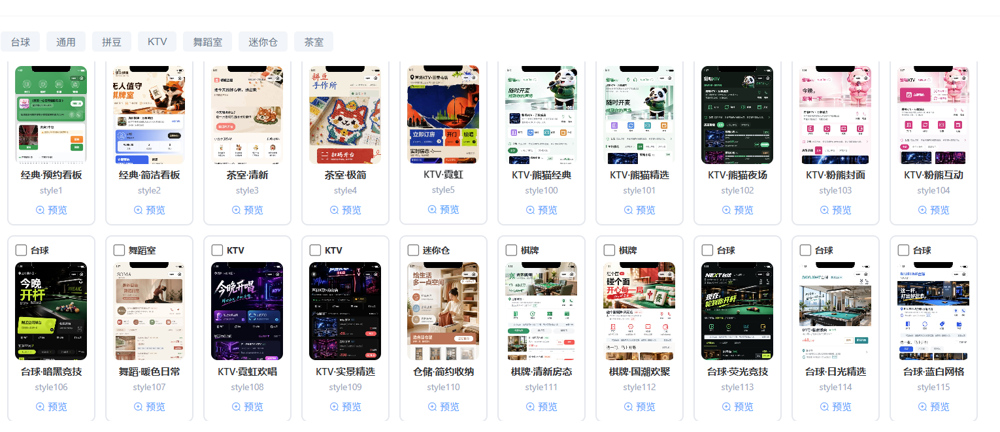
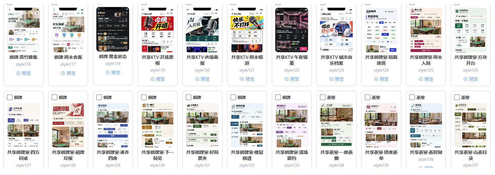
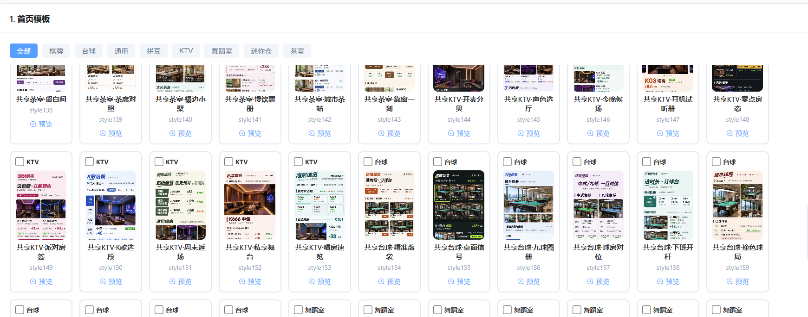
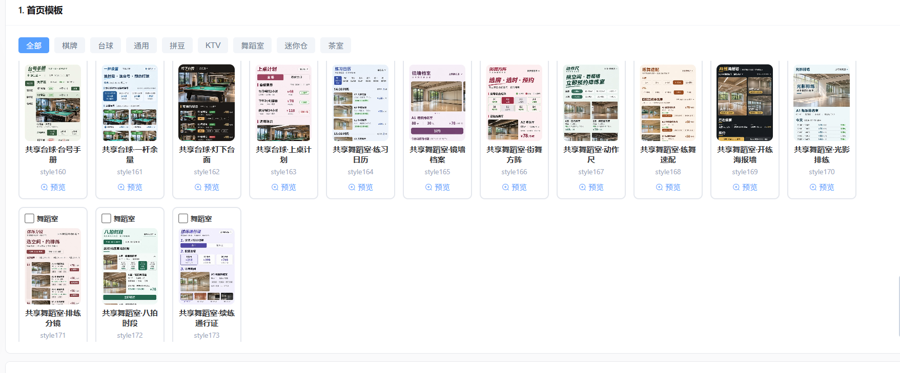

# 云掌柜共享空间 · Cloud Steward

云掌柜共享空间是一套面向无人值守门店的分时预约与运营系统，包含 **PC 管理后台、顾客微信小程序、手机管理端**。顾客可选店、查房态、预约付款、团购兑换和自助入场。运营人员可管理多门店、空间定价、会员营销、IoT 设备、支付对账、商品、寄存与保洁任务。

[下载源码 ZIP](https://github.com/jthong/sharespace-sale/archive/refs/heads/main.zip) · [海量模板](#海量模板) · [功能清单](#功能清单) · [业务操作手册](code/云掌柜共享空间-业务操作手册.html) · [公开源码范围](#公开源码范围)

> **公开源码节选，无法直接运行完整后端**。当前版本可查看三端页面、产品流程、接口设计和数据结构。预约订单和设备控制各有一份实现未包含在当前下载包中。如需完整源码或部署支持，请[联系获取完整版本](#联系与合作)。

## 海量模板

首页模板示例覆盖 **自助棋牌室、共享台球厅、自助 KTV、共享茶室、共享舞蹈室、拼豆手作、迷你仓及通用共享空间**。截图可用于对比预约看板、时段日历、房态列表、空间图册和营销入口的布局。具体可选模板、模板资源和门店配置由实际部署提供。

## 适用场景

| 业态 | 运营方式 | 对应功能 |
| --- | --- | --- |
| 自助棋牌室、麻将馆 | 按小时预约不同包间，按需配置门禁、电控和保洁 | 包间房态、团购核销、续时换房、用后保洁 |
| 自助台球厅、共享球房 | 把球台或独立包间设为可预约资源 | 球台预约、时段定价、通电开台、语音到期提示 |
| 自助 KTV、共享影音空间 | 按包厢、时长和可用时段安排消费 | 分时价格、包厢套餐、会员优惠、入场与续时 |
| 共享茶室、无人茶空间 | 按包间和时段接待预约 | 门店展示、团购套餐、优惠券、订单和押金 |
| 共享舞蹈室、排练室 | 按房间及课余、排练时段开放预约 | 可订日历、空闲房态、独立门禁、移动端值班 |
| 拼豆手作、迷你仓及其他共享空间 | 按实际营业方式选择首页模板和资源分类 | 门店运营、资源展示和分时预约能力 |

## 业务流程

1. **开店配置**。平台管理员建立租户、门店和空间，配置后台角色及门店范围。运营人员设置营业时段、房型、分时价格、押金、套餐和页面模板。
2. **顾客预约**。顾客在微信小程序查房态，选日期、开始时间和时长。结算页核对微信付款、余额、优惠券、时长套餐或美团与抖音团购券的可用条件。
3. **自助入场**。订单确认后进入订单详情。可入场时使用「通电开门」。有独立门禁的门店可另行配置「门店大门」。设备操作记录用于确认下发的动作，实机结果可在现场验收。
4. **续时与结单**。按订单状态和空闲时段续时或换房。到期或提前结束后，系统按门店设置处理设备、押金和订单状态。
5. **保洁和对账**。需要保洁的空间在订单结束后生成任务。保洁员在手机端接单和交付，运营人员查看结算记录、支付退款流水和门店经营数据。

## 功能清单

[PC 后台](#pc-后台) · [用户端](#用户端) · [手机管理端](#手机管理端) · [接入条件](#接入条件)

### PC 后台

平台管理员、商户负责人和门店运营人员根据账号权限访问对应菜单和门店数据。

| 模块 | 功能 | 操作说明 |
| --- | --- | --- |
| 账号与权限 | 后台登录 | 输入账号和密码，系统根据账号关联租户。 |
| 账号与权限 | 租户、账号与权限 | 管理租户、账号、角色、菜单权限和数据范围。 |
| 账号与权限 | 员工与保洁员 | 管理手机端的商户负责人、店长、管理员和保洁员，查看岗位和状态。 |
| 经营分析 | 经营概览 | 查看当前门店当日订单净收、新增预约、进行中订单、空闲空间及近 14 天净收趋势。 |
| 门店与空间 | 门店管理 | 新增门店，维护名称、地址、联系方式、状态和服务期限。 |
| 门店与空间 | 公告与门店码 | 维护公告、Wi-Fi 说明和联系方式，查看或重新生成预约码、续时码。 |
| 门店与空间 | 空间及价格 | 管理空间名称、类别、等级、图片、小时价、分时价格、押金及最短预约时长。 |
| 门店与空间 | 实时房态 | 查看空闲、已预约、使用中、待保洁和停用状态，按权限启停空间。 |
| 门店与空间 | 现场协助 | 在实时房态执行开门、通断电、提前结单或完成保洁等操作。 |
| 预约订单 | 代客预约与查询 | 为客户建单，按门店、状态或时间查阅预约、实付和退款记录。 |
| 预约订单 | 变更预约 | 按订单状态调整结束时间、更换空间、修改时段或变更客户。 |
| 预约订单 | 取消和押金 | 根据权限与订单状态取消、退款或退还押金，查询处理结果。 |
| 会员营销 | 门店会员 | 查询会员资料、余额、赠送余额、积分和 VIP 等级，按权限充值余额、调整等级。 |
| 会员营销 | 会员黑名单 | 添加或移出当前门店的会员黑名单。 |
| 会员营销 | 充值规则 | 配置充值金额、赠送金额、有效期和启用状态。 |
| 会员营销 | VIP 规则 | 设置积分门槛、等级名称和消费折扣。 |
| 会员营销 | 优惠券创建 | 创建抵扣券、满减券或加时券，设置使用门槛、有效期和适用空间。 |
| 会员营销 | 赠券与记录 | 向指定门店会员赠送优惠券，查询持有人和使用状态。 |
| 会员营销 | 时长套餐 | 配置售价、时长、有效期、限购、适用空间、星期及节假日规则，关联平台商品。 |
| 支付财务 | 微信服务商收款 | 在门店管理绑定每家门店的微信特约商户号。 |
| 支付财务 | 支付与退款 | 按订单号查看支付和退款流水，按权限发起原渠道退款。 |
| 支付财务 | 会员资金流水 | 查阅普通余额与赠送余额的充值、消费和退款变动。 |
| 团购 | 门店绑定 | 将一个团购服务商门店 ID 与一个系统门店对应。 |
| 团购 | 美团及抖音授权 | 在门店列表分别发起美团团购授权、抖音团购授权。 |
| 团购 | 商品关联与核销记录 | 在时长套餐维护平台商品关联和适用范围，查询团购券核销记录。 |
| 设备 | 网关登记与配网 | 登记网关编号、绑定门店，点击配网后自动获取子设备，也可手动同步。 |
| 设备 | 类型识别与绑定 | 根据 UIID 识别电控、门禁和音箱。新同步设备归属网关所在门店，管理员按接线绑定空间。 |
| 设备 | 设备状态及操作记录 | 查看在线状态，按门店和空间追溯开门、通断电等设备操作。 |
| 设备 | 语音播报 | 按空间类别配置进场欢迎语、到期提醒和结束提示。 |
| 保洁 | 保洁任务 | 查看进度、关联订单和交付记录，按权限取消任务。 |
| 保洁 | 保洁结算 | 按保洁员和期间办理结算，查看结算金额及任务记录。 |
| 保洁 | 通知渠道 | 在门店配置企业微信群机器人或小程序订阅消息。超级管理员维护共用模板及字段。 |
| 商品与寄存 | 商品及分类 | 管理分类、图片、售价、库存和上下架。PC 可编辑单规格商品、查询多规格商品。 |
| 商品与寄存 | 商品订单 | 查询商品、数量、实付及状态，确认交付后完成订单。 |
| 商品与寄存 | 商品寄存 | 设置可寄存商品和计量单位，办理存取，查询有效期及出入记录。 |
| 平台运维 | 展示及系统维护 | 管理门店展示模板和广告，按权限查看登录、操作及接口日志，维护文件、定时任务和系统参数。 |

### 用户端

面向顾客的微信小程序，覆盖选店、预约、结算、入场和订单操作。

| 模块 | 功能 | 操作说明 |
| --- | --- | --- |
| 账号 | 微信登录与资料 | 微信登录，按页面流程绑定手机号，查看并维护个人资料。 |
| 门店 | 门店浏览及导航 | 浏览门店、查看地址和联系方式，按需使用定位与导航。 |
| 空间 | 空间详情与房态 | 查看空间照片、类型、价格和预约时段。 |
| 预约 | 选时段与下单 | 选择空间、日期、开始时间和时长，核对可订时段及金额。 |
| 预约 | 扫码预约及续时 | 通过预约码进入预约，通过续时码进入对应订单的续时流程。 |
| 结算 | 微信支付 | 核对金额后付款，支付确认后进入订单详情。 |
| 结算 | 余额及押金预约 | 根据门店配置选择余额支付或押金预约，查询支付结果。 |
| 结算 | 使用优惠券 | 选择符合适用门店、空间、门槛和有效期的券，核对实付或可用时长。 |
| 结算 | 时长套餐 | 查看并购买可售套餐，按有效期和适用范围预约。 |
| 团购 | 验券及兑换 | 输入或扫描美团、抖音券码，核对券信息及适用空间后兑换下单。 |
| 入场 | 通电开门 | 到可入场时间，在订单详情点击「通电开门」。 |
| 入场 | 独立门禁及空调 | 有独立大门门禁的门店可从订单详情操作「门店大门」，空调控制随实际设备启用。 |
| 订单 | 订单查看及分享 | 在「我的订单」查看预约记录、时间、金额和状态，按需分享订单或联系门店。 |
| 订单 | 续时、换房及结束 | 按订单状态和空闲情况执行续时、换房或提前结束。 |
| 订单 | 取消与退款 | 在符合条件的订单上申请取消或退款，查看押金和退款结果。 |
| 会员 | 优惠中心与领券 | 查看门店充值优惠和套餐，通过领券活动领取优惠券。 |
| 会员 | 钱包和流水 | 查看余额、赠送余额及流水，选择适用的充值规则。 |
| 商品 | 商品购买 | 浏览商品、下单并查看商品订单及交付状态。 |
| 寄存 | 寄存查询 | 在个人中心查看本人寄存物品和记录。 |

### 手机管理端

门店人员使用同一个微信小程序，在「个人中心 → 功能专区」进入岗位对应的菜单。

| 岗位 | 功能 | 操作说明 |
| --- | --- | --- |
| 商户、店长 | 门店设置 | 切换有权限的门店，维护资料、公告、客服和展示内容。 |
| 商户、店长 | 空间设置 | 维护空间资料、价格、押金、预约规则，按需设置预付费。 |
| 商户、店长 | 房间控制 | 查询房态，按权限协助开门、通电、结束使用或完成保洁。 |
| 商户、店长 | 设备维护 | 查看设备列表，进入对应的设备和门锁配置。 |
| 商户、店长 | 订单管理 | 查看预约，协助代客下单、续时、换房、结单或退款。 |
| 商户、店长 | 会员管理 | 查询会员和余额，维护会员等级、黑名单及使用权限。 |
| 商户、店长 | 定向发券 | 创建优惠券后选择「赠送用户」，也可在会员详情发券、查询及回收。 |
| 商户、店长 | 领券活动 | 发起并分享领券活动，供顾客领取，按需结束活动。 |
| 商户、店长 | 充值与套餐 | 配置充值赠送、VIP 折扣、时长套餐及适用范围。 |
| 商户、店长 | 团购验券 | 选择门店，协助顾客扫码或输入券码，查看验券结果。 |
| 商户、店长 | 支付订单 | 查询支付状态，按权限处理退款。 |
| 商户、店长 | 商品配置 | 管理分类、商品规格、图片、价格、库存及上下架。 |
| 商户、店长 | 商品交付 | 查询门店商品订单，按订单状态确认交付。 |
| 商户、店长 | 人员管理 | 按门店为员工配置相应的管理或保洁身份。 |
| 商户、店长 | 保洁运营 | 查看保洁订单、进度及交付情况，按权限处理异常和办理结算。 |
| 商户、店长 | 语音与经营统计 | 设置语音播报内容，查看订单和收入等经营数据。 |
| 保洁员 | 任务大厅 | 查看所绑定门店的任务，接单、开始或按任务状态取消。 |
| 保洁员 | 入场与用电 | 开始任务后，按页面权限操作「开门开电」或「仅开门锁」。 |
| 保洁员 | 交付与结算 | 提交保洁交付记录并完成任务，在任务统计查看结算。 |
| 保洁员 | 微信订阅提醒 | 在任务大厅点「订阅提醒」并允许，接收符合条件的订单结束通知。 |

### 接入条件

| 接入 | 启用条件 |
| --- | --- |
| 微信支付 | 配置小程序 AppID、服务商凭证和支付回调，并为门店绑定已开通的微信特约商户号。 |
| 美团、抖音团购 | 绑定团购服务商门店并完成对应平台授权，再核对平台商品和适用空间。预检和核销使用同一平台识别规则。 |
| 空间设备 | 网关需在线。电控、门禁、音箱需绑定对应空间，独立门店大门按现场需要配置。可通过操作记录核查指令下发，通过现场验收确认动作。 |
| 企业微信保洁提醒 | 门店填写企业微信群机器人地址，在「保洁通知」选择企业微信渠道。 |
| 微信小程序保洁提醒 | 超级管理员保存对应 AppID 的模板及字段映射。发布含「订阅提醒」的小程序版本后，门店启用渠道，由保洁员在任务大厅授权。 |
| 商品、会员和保洁 | 按门店设置商品、权益和人员岗位，按空间配置保洁规则。 |

## 工程目录

| 目录 | 用途 |
| --- | --- |
| [Java 服务端](code/cloudsteward_server) | Spring Boot、MyBatis-Plus、MySQL 和 Redis，包含预约、会员、支付、团购、设备、保洁及系统管理接口。 |
| [PC 管理后台](code/cloudsteward_server/cloudsteward-ui-admin) | Vue 2 和 Element UI，提供门店工作台、设备与空间管理、订单财务和系统配置页面。 |
| [微信小程序](code/wechat-user) | 原生微信小程序，提供顾客预约、支付和入场，以及商户运营与保洁任务大厅。 |
| [MySQL 结构](code/cloudsteward_server/sql/schema.sql) | 数据库建表结构，适合核对实体及业务关系。 |
| [业务操作手册](code/云掌柜共享空间-业务操作手册.html) | PC 后台、用户端和手机管理端的操作路径。可下载后在浏览器查看。 |

## 公开源码范围

| 内容 | 当前公开版 |
| --- | --- |
| 三端界面 | 包含 PC 管理后台、顾客微信小程序、手机管理端和保洁任务页。 |
| 服务端参考 | 包含控制器、接口定义、数据模型、映射、测试及部分业务实现。 |
| 两个核心实现 | 预约订单实现 `AppOrderServiceImpl.java`、设备控制实现 `DeviceServiceImpl.java` 留在完整工程。当前公开版本无法作为完整后端直接运行。 |
| 数据和部署配置 | 提供 MySQL 建表结构与配置示例。正式部署需要自己的数据库、Redis、租户、账号、支付及设备接入配置。 |
| 模板 | README 展示首页模板样例。可选模板及页面素材按部署环境中的配置和资源提供。 |

[下载当前公开版 ZIP](https://github.com/jthong/sharespace-sale/archive/refs/heads/main.zip)

## 阅读和联调

- **看 PC 页面**。进入管理后台目录，使用 `npm ci` 安装依赖，复制 `.env.dev.example` 为 `.env.dev` 并填写 API 地址，再执行 `npm run dev`。页面的数据和操作需要可用的服务端接口。
- **看小程序页面**。在微信开发者工具中导入 `code/wechat-user`。联调时使用自己的小程序 AppID，并设置 `app.js` 的 `baseUrl`。微信支付、订阅消息等能力需要对应平台配置。
- **看后端与数据库**。从 Java 8、Maven 多模块结构、`schema.sql` 及 `application-dev.yaml.example` 了解接口和配置。恢复完整后端需要提供本版未发布的两份实现与实例环境配置。
- **看门店配置和对接**。从操作手册查阅门店权限、微信支付服务商、美团与抖音门店授权、物联网网关、房间绑定、优惠券和保洁通知。旧款蓝牙网关依赖部署方配置对应 SDK。

## 常见问题

### 这套系统适合几个门店？

数据按租户、门店和账号权限管理。可用于单店配置，也有多门店工作台与平台账号管理。

### 可以只用预约和支付吗？

门店可按需要配置独立大门、音箱、团购、商品和保洁。微信付款、会员余额、优惠券或团购券的可用项以实际门店配置为准。

### 团购券为什么不能使用某个包间？

核对美团或抖音店铺授权、券对应的商品和时长套餐，并检查适用空间、日期和时间段。

### 订阅提醒为什么没收到？

检查门店是否启用小程序通知渠道、小程序是否发布了「订阅提醒」入口、模板字段配置和保洁员授权。企业微信渠道应检查群机器人地址和门店选择的渠道。

## 相关检索词

- **无人自助门店**　共享空间管理系统、无人值守门店、场地预约系统、包间预约小程序、自助棋牌室系统、无人台球厅、共享茶室、自助 KTV、舞蹈室预约。
- **门店数字化运营**　微信小程序预约、微信支付服务商、美团团购核销、抖音团购核销、会员充值、优惠券发放、时长套餐、房态管理、保洁工单。
- **技术与设备**　多租户 SaaS、Spring Boot、Vue 2、WeChat Mini Program、IoT 网关、智能门禁、共享空间自助开门、通断电、语音播报。
- **English**　shared space booking system, self-service venue management, room reservation software, WeChat Mini Program booking, IoT access control, multi-tenant venue SaaS, group-buy voucher redemption.

## 联系与合作

获取完整源码、部署支持或商务合作

- 电话 `15392033006`
- 微信 `hxt15392033006`

## 授权

已公开的自有代码采用 [MIT](LICENSE)。第三方组件保留原授权，见[第三方声明](THIRD_PARTY_NOTICES.md)。
